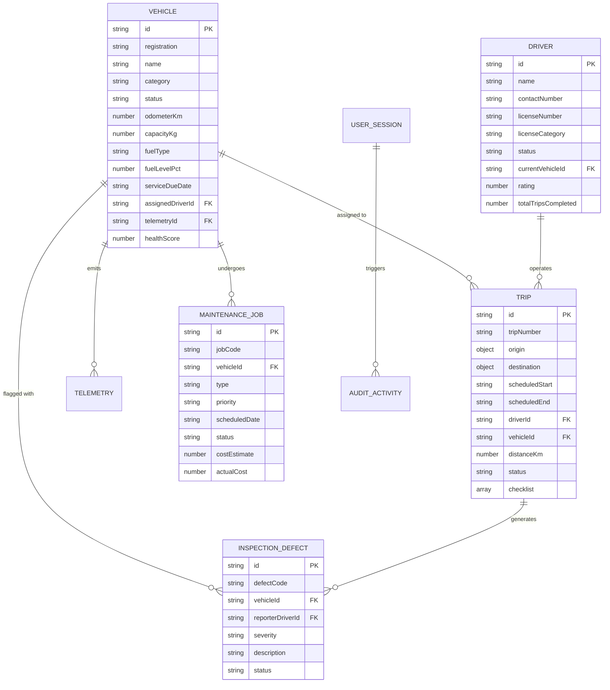
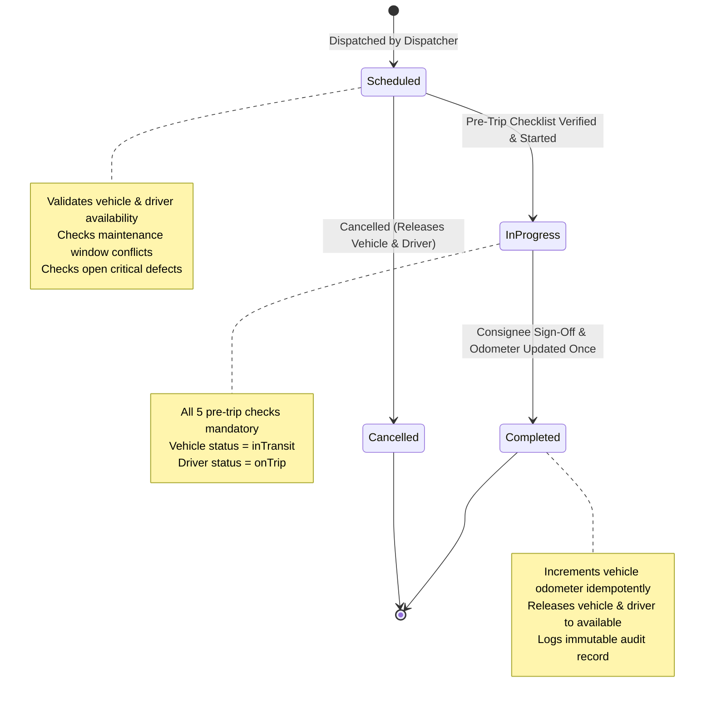

# Architecture & Technical Design Specification
## FleetPulse Logistics Operating System
**Jeevix Technologies** — Enterprise Frontend Engineering  
**Author:** Chandan Mayur A | Presidency University  

---

### 1. System Architecture Overview
FleetPulse is constructed using Next.js 14 App Router, TypeScript (strict mode), Tailwind CSS, and a canonical reactive state engine backed by versioned browser storage. All domain operations are decoupled from presentation components through isolated business logic modules.

```
┌─────────────────────────────────────────────────────────────────┐
│                      Next.js 14 App Router                      │
│   /dashboard   /vehicles   /tracking   /trips   /driver   ...   │
└────────────────────────────────┬────────────────────────────────┘
                                 │
┌────────────────────────────────▼────────────────────────────────┐
│               FleetProvider (React Context + Reducer)           │
│  - State Hydration & Versioned Persistence (localStorage)       │
│  - Real-Time Telemetry Simulation Ticker (4000ms loop)          │
│  - Client-Side Role Demo Authorization (Dispatcher/Driver/Admin)│
└───────────────┬────────────────────────────────┬────────────────┘
                │                                │
┌───────────────▼───────────────┐┌───────────────▼────────────────┐
│      Domain Logic Engines     ││       Validation & Storage     │
│ - conflicts.ts (Overlap/Slots)││ - schemas.ts (Zod Forms)       │
│ - lifecycle.ts (State Machine)││ - storage.ts (Safe Hydration)  │
│ - metrics.ts (Derived KPIs)   ││ - csv.ts (Injection Defense)   │
│ - mockClient.ts (REST Envelop)││ - seedData.ts (Fixtures)       │
└───────────────────────────────┘└────────────────────────────────┘
```

---

### 2. Entity-Relationship Model (Mermaid)



---

### 3. Trip Lifecycle State Machine (Mermaid)



---

### 4. Overlap & Scheduling Algorithm
The conflict detection engine verifies two closed intervals $[startA, endA)$ and $[startB, endB)$:
$$\text{Overlap} \iff startA < endB \land endA > startB$$
Crucially, adjacent contiguous slots where $startA = endB$ or $endA = startB$ are **strictly allowed**, enabling sequential back-to-back dispatch without artificial gaps.
